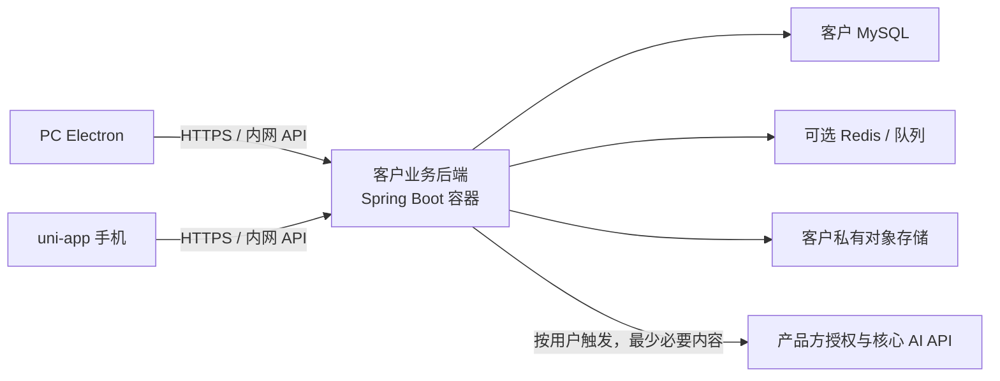

# 后端代码位置与部署边界

## 当前代码落点

这里的“后端放哪里”指**源码目录**和**运行主机**两件事：源码在 Yudao Spring Boot 工程中；运行时作为一个独立服务部署在客户服务器/私有云，或由我们托管。Electron 安装包只包含桌面前端与受限桌面桥接，不包含 Spring Boot、MySQL，也不直接连接数据库。PC 与 uni-app 手机都访问同一业务 API。

| 部分 | 代码位置 | 运行位置 | 职责 |
|---|---|---|---|
| PC 桌面端 | `apps/pc/` | 用户电脑 | Electron + Vue 客户端，只保存短期会话和必要的加密离线队列 |
| 移动端 | `apps/call-phone-uni/` | Android / iOS 手机 | uni-app；调用现有原生拨号、录音插件，访问同一客户数据 API |
| 客户业务后端 | `apps/ruoyi-vue-pro/yudao-server/` 和 `yudao-module-*` | 客户自有服务器或我们托管的业务环境 | Spring Boot 数据平面：身份、客户、线索、外呼、设备配对、上传任务等 |
| 管理模板前端 | `apps/ruoyi-vue-pro/yudao-ui-admin-vue3/` | 浏览器或后续 Electron 渲染器 | 芋道现有 Vue 3 + Element Plus 管理 UI 与业务页面资源；按产品模块复用 |
| 产品方控制/核心服务 | 后续单独仓库/服务，当前尚未创建 | 我们控制的云端 | 部署授权、订阅与配额、核心 AI / 高价值能力；不代理存取 CRM 主数据 |

`apps/ruoyi-vue-pro/` 是独立的嵌套 Git 仓库。当前将它作为后端和管理模板底座；Call Phone 的 Java 领域代码应加入该仓库中的 Yudao 模块，不放进 `apps/pc/electron`。目录名是否在抽取模板后调整，不影响运行边界。

## 部署拓扑

- 桌面端不是后端主机；数据库连接串、服务端密钥和业务规则不打进 Electron 包。PC 与手机都作为客户端连接同一个业务 API。
- 自部署时，Spring Boot、MySQL、可选 Redis、对象存储配置由客户在自己的服务器、NAS/内网主机或私有云运行。桌面与手机经局域网、VPN 或客户 HTTPS 域名连接；外出移动网络访问需由客户提供受控入口。
- 托管模式运行同一业务后端与 schema，由我们负责基础设施；不能因此把自部署业务数据库同步到产品方控制平面。
- 单机完全离线、只有一位桌面用户的部署可以以后评估本地 sidecar + SQLite，但它不是首期默认：手机配对、并发、备份与跨设备数据同步都要求有可访问的服务端。
- 许可证验证失败不得破坏或加密客户业务数据库。数据平面 CRUD 和核心云能力授权分开；AI 调用由客户后端显式发起，并说明出站字段。

## 后端模块落点

首期继续复用 Yudao 的 Spring Boot 模块化单体、MyBatis、权限、租户、字典、文件、定时任务和管理端组件，不新建微服务：

**当前仓库状态：**根 `pom.xml` 目前只启用 `yudao-module-system` 与 `yudao-module-infra`；`yudao-module-crm` 在根 Maven reactor 和 `yudao-server/pom.xml` 中均被注释。因此 CRM 源码虽存在，当前服务构建不会加载它。Call Phone 首期客户/线索方案不要求启用 CRM。桌面端 `apps/pc/` 也只有空目录结构，尚无 Electron 项目配置。管理模板 UI 在 Yudao Vue3 管理端；Electron renderer 应复用并在构建时打包这套 Vue 资源，避免另造一套组件系统。

| Call Phone 模块 | 当前复用底座 / 代码所有者 |
|---|---|
| 组织、账号、角色、菜单、权限、字典、审计、文件 | `yudao-module-system` / `yudao-module-infra` |
| Call Phone 客户、跟进、客户字段与标签 | `yudao-module-callphone` 拥有自己的领域模型与表；成员/角色身份复用 system API |
| Call Phone 线索、分配、转化与归档 | `yudao-module-callphone` 拥有自己的线索生命周期；转化在本模块事务内写客户实体 |
| 外呼派发、通话事件、桌面/手机配对 | `yudao-module-callphone` outbound 包；复用 Yudao 公共身份/租户/权限能力 |
| 拓客渠道、追踪码、物料、归因 | `yudao-module-callphone` acquisition 包；通过稳定 ID 关联本模块客户/线索 |
| 话术、知识库、AI 请求 | Call Phone 模块拥有配置、权限、运行记录与审核；保护推理经产品方核心 API。首期不依赖可选 `yudao-module-ai` 业务模块 |
| 企业微信与会话服务 | Call Phone 模块内维护隔离适配器；企微授权和 API 能力核验完成后启用，不依赖 CRM 内部实现 |

为让产品业务代码留在单一模块，首期客户与线索数据由 Call Phone 模块自有，不把 CRM 源码或 `crm_*` DO/Mapper 拉入依赖。现有 Yudao CRM 只作为参考实现和未来可选互操作源；如后续要导入既有 CRM 客户，通过显式迁移/适配 API 完成，不做跨模块直连表。新表使用 `cp_` 前缀并遵循 Yudao tenant、审计和逻辑删除基类。姓名/号码按公共契约加密、掩码并用密钥化搜索哈希，不能照抄模板普通明文 `mobile` 字段。

**命名决策：**Call Phone 产品后续不只包含电话能力，但目前没有比产品名更清楚且不冲突的 Maven 模块名，因此先采用 `yudao-module-callphone`。这里的 `callphone` 是产品业务域标识，不代表该模块只能放拨号功能。自有业务按 outbound、customers、leads、acquisition、AI adapter 等包划分；只有首批先实现 outbound。仓库已有 `yudao-module-mall`，因此不采用容易与商城域混淆的 `yudao-module-market`。

**边界说明：**Call Phone 并非技术上必须放在 `ruoyi-vue-pro` 仓库。放在其中的理由是复用 Yudao 的登录、租户、权限、MyBatis 和基础设施；不是让业务逻辑散落进 Yudao 各模块。若采用此路径，正常只需要两个装配改动：根 `pom.xml` 将新模块加入 reactor，`yudao-server/pom.xml` 引入该模块。Call Phone 的实体、Controller、Service、Mapper、迁移 SQL、权限初始化和业务配置放在新模块自身；禁止修改或复制 CRM/ERP 等业务模块。运行时对通用系统身份/权限能力的依赖通过 Yudao 公共 framework/system API 接入，不直接 import CRM 内部 DO、Service 或 Mapper。

如果连这两处 Maven 装配也不希望和模板源码耦合，可以另建独立 Spring Boot 服务/仓库；但需要自行维护登录鉴权、租户上下文、权限、审计和数据库迁移，或将这些公共能力抽为可独立依赖的发行包。按当前“减初期开发量、限制业务耦合”的目标，推荐先使用独立 `yudao-module-callphone`，只接受两处构建装配改动，不依赖 Yudao CRM 业务模块。若以后需要客户/线索数据，由稳定 API/应用服务边界连接；不要让外呼模块直接查询 CRM 表。

## 本机开发与生产配置

- 本地开发可由 Docker Compose 启动后端依赖（MySQL、Redis）和 Spring Boot；生产安装包由客户自行配置数据卷、备份、TLS 域名、对象存储和升级窗口。
- 桌面端配置客户 API Base URL；不得让用户填数据库连接串。手机端配对时也绑定同一 workspace/tenant 与该业务 API。
- 产品方控制平面 URL 与客户数据平面 URL 使用独立配置、独立 token、独立审计；产品方 API 不接收姓名、手机号、原始录音、客户 ID 或客户数据库凭证。

## 实施顺序

1. 先锁定下一个文件 [`docs/contracts/api-data-conventions.md`](../contracts/api-data-conventions.md) 中的公共规则及各模块契约。
2. 在 `yudao-module-callphone` 内建立客户/线索业务模型，复用 Yudao system 身份、租户和权限基础；不直接依赖 CRM 源码。若要导入现有 CRM 数据，再单独设计映射与迁移。
3. 在 Yudao 单体实现设备配对与外呼垂直闭环：PC 发起 → 手机确认/拨号 → 结果回填 → PC 查询。
4. 再按拓客、AI、企微/质检等业务模块逐页实现 PC UI、后端 API、迁移和权限，不按菜单叶子创建独立服务。

逐页数据库/API 契约及各页接口权限见[页面、数据表与 API 契约总表](../contracts/page-api-matrix.md)。目前这些是设计基线，尚不表示这些接口或 Call Phone 后端模块已经写入代码。
