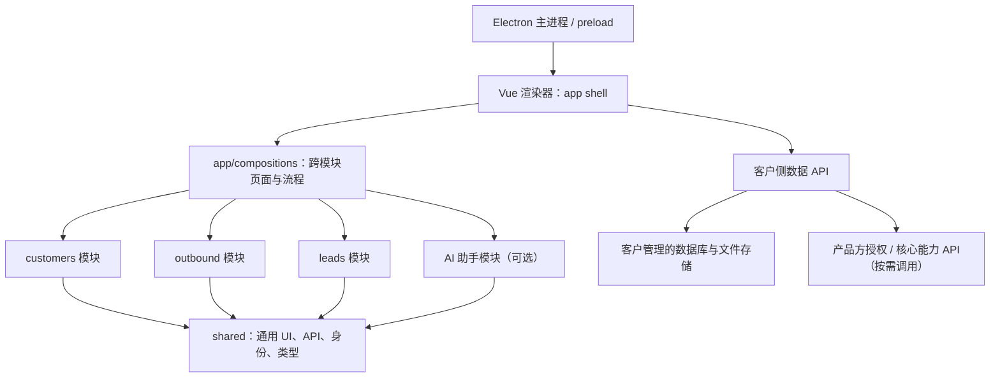

# PC 端模块化架构罗盘

> 状态：Call Phone PC 端开发基线。目标是用清晰的业务边界降低页面、API 和授权逻辑的相互牵连；首期不引入微前端或运行时下载插件。

## 决策摘要

- 桌面应用采用 **Electron + Vue 3 + TypeScript + Vite**。Electron 负责桌面窗口、更新和受控系统能力；Vue 渲染进程承载应用 UI 与业务模块。
- 前端按业务域组织为**模块化单体**：单个安装包、单个渲染器、单个版本发布。页面可以按路由懒加载，但代码随签名安装包构建，不从远端拉取可执行模块。
- 模块粒度按业务域划分，而不是每个菜单叶子单独一包。第三级菜单是一条页面路由；一个业务模块可注册多个第三级页面。
- `shared` 只放跨域通用能力，代码依赖方向固定为 `app/compositions → modules → shared`（越往右越底层）。`shared` 永远不能引用业务模块；业务页面的跨模块组合放在更上层。
- 菜单和权限数据可以由服务端下发，实际页面组件必须匹配前端编译期白名单。客户端隐藏菜单只改善体验，数据和操作权限必须由服务端重新验证。
- PC 不直接访问数据库。客户数据走客户侧数据平面；产品方授权/核心服务与客户业务数据分离。

## 逻辑结构



箭头表达代码依赖或请求方向。`shared` 不知道谁在使用它；后端模块由 Yudao 单体按业务边界提供 API，不代表 PC 端需要拆成多个前端应用。

## 建议目录

```text
apps/pc/
  electron/
    main/                 # 窗口、更新、系统生命周期
    preload/              # 最小、白名单 IPC 接口
  src/
    app/
      bootstrap/          # 应用启动、依赖装配
      router/             # 静态允许路由注册
      navigation/         # 服务端菜单到本地路由的匹配
      compositions/       # 需要多个模块的页面、用例和扩展注册
    shared/
      ui/                 # 按设计系统实现的通用、无业务组件
      api/                # HTTP 客户端、响应信封、错误处理
      auth/               # 会话与通用身份上下文
      platform/           # typed DesktopBridge、通用存储封装
      types/              # ID、时间、分页等跨域基础类型
    modules/
      customers/
      outbound/
      leads/
      acquisition/
      ai-assistant/
      system-settings/
```

单个模块的内部组织示例：

```text
modules/outbound/
  manifest.ts             # 模块 id、菜单路由、权限 key、功能 key
  routes.ts
  pages/
  components/             # 仅本模块使用的业务组件
  api/                    # 本模块 API 适配器
  types/                  # 本模块 DTO 与 UI 模型
  usecases/               # 本模块用例、状态转换
  state/                  # 本模块状态；不把业务状态放进全局 store
  public.ts               # 有意提供给其他模块/组合层的最小 API
```

客户和外呼等领域模块分别定义 DTO、接口、页面状态和数据行为。共用 HTTP 客户端和 API 信封放在 `shared/api`，具体 URL、查询参数和业务错误映射属于相应模块。

## 依赖规则

### `shared` 是底层通用依赖

`shared` 可以包含 HTTP/时间/分页/错误处理、权限指令框架、通用表单/表格/弹窗、设计 token、无业务含义的本机桥接接口等。

`shared` 不包含 `CustomerCard`、`CallRecord`、客户查询 API、外呼流程或某个业务的枚举。某组件若需要知道客户、线索、通话、配对、授权等领域概念，它就不是 shared 组件。

### 模块间依赖必须显式且无环

- 优先由 `app/compositions` 同时调用两个模块的公开入口进行组装。
- 特定领域确有稳定依赖时，只能从另一个模块的 `public.ts` 导入，不得穿透到其内部 `pages/`、`state/`、`api/` 或私有组件。
- 模块依赖图必须是有向无环图。新增依赖前检查它是否会形成反向引用或环；禁止 `customers → outbound → customers`。
- 通用 DTO 只有在语义真正跨域时才进入 shared。领域对象不能为了省一次 import 被改名或塞入 shared。
- 不用一个无类型、随处发布事件的全局 EventBus 代替契约。异步领域事件需要明确事件名、payload、所有者和失败处理。

## 一个组件需要多个模块时怎么处理

不要把它搬进 `shared`。先分清它是通用展示组件，还是跨模块业务组合：

1. **纯 UI、无业务含义**：如确认弹窗、状态标签壳、头像、日期格式组件，可进入 `shared/ui`。
2. **一个模块拥有的能力，被别处使用**：由拥有者在 `public.ts` 提供 typed use case/API，其他模块通过公开接口调用；UI 仍由能力所有方管理或由组合层呈现。
3. **一个页面/流程要同时编排多个模块**：放在 `app/compositions`。组合层依赖 `customers/public` 与 `outbound/public`，各模块无需相互反向依赖。
4. **多个可选模块要向同一个页面扩展**：为组合层定义有类型的 extension slot，模块 manifest 注册贡献项；组合层负责校验权限、功能开关并渲染。只有出现重复扩展需求后再抽象 slot，不要首期预建通用插件市场。

例如客户详情里的“发起外呼”按钮与通话历史都属于跨客户/外呼的组合能力。客户模块提供客户详情和稳定的客户摘要类型；外呼模块拥有“创建通话/读取通话历史”的用例；组合层把二者装配在客户详情页。客户模块不能直接 import 外呼页面或 store，shared 也不能知道“拨号”这个业务动作。

建议将 `app/compositions` 理解为组合根，不成为第二个业务大杂烩：它负责安排交互顺序、把模块输出放到页面插槽、显示跨模块状态；客户规则留在客户模块，通话状态规则留在外呼模块。

## 模块注册、路由与服务端菜单

模块在代码中静态注册，示例：

```ts
export const outboundModule = {
  id: 'outbound',
  routes: [{
    id: 'customers.call-records',
    path: '/customers/calls',
    component: () => import('./pages/CallRecordsPage.vue'),
    permission: 'call:record:list',
    feature: 'outbound.calling'
  }]
}
```

- `id`、route id、权限 key 和 feature key 使用稳定机器标识，不使用中文菜单名作代码标识。
- 服务端第三级菜单按 route id/path 匹配前端白名单；一级/二级项只作为分组。服务端返回未知路径时拒绝挂载并记录配置错误。
- 页面显示条件为：该模块已编译进当前版本、当前租户/部署允许该功能、用户拥有页面权限。按钮动作还要有动作权限。
- 应用可按部署配置关闭可选模块；不因此从运行时动态下载新 JS。授权仅用于产品方控制平面的核心功能；服务端数据/API 权限仍独立强制执行。
- 路由按页面懒加载，避免首屏下载全部业务页面；这属于构建优化，不等于插件动态安装。

## Electron 安全边界

- 主进程不承载业务规则、不直接连业务数据库、不存放云端长期密钥。
- Renderer 开启 `contextIsolation`，关闭 `nodeIntegration`，启用 sandbox；业务代码不能直接获得 Node.js、文件系统或任意 IPC 能力。
- Preload 只暴露必要的、逐项列出的 typed API；`shared/platform` 提供稳定接口，具体 Electron 实现留在 preload/main 组合处。
- 文件选择、系统通知、更新等系统动作经最小权限桥接；客户 API 认证仍走 HTTPS 短期令牌。Electron 包签名/更新签名由受控发布链路管理。

## 数据与 API 所有权

- PC 是 API 客户端，不直接连接 MySQL/Redis，也不共享一个全局“万能业务 store”。
- 每个领域模块拥有自己 API 适配器与前端 DTO；跨模块只通过公开用例或组合层传递必要数据。
- `/api/v1` 的 API 契约先于页面集成定义；Yudao 后端可映射到自己的路由规范，不能让 UI 依赖生成代码或 ORM 实体。
- 手机号和录音访问在数据平面再次鉴权。产品方授权 API 只接收最小授权/部署元数据，不能成为 CRM 数据代理。
- 全局会话、工作区和 UI 外壳状态可放 `app`；模块列表筛选、详情数据和通话流程状态由相应模块持有。
- 离线缓存框架可以由 shared 提供加密、队列、重试工具；缓存字段、生命周期和同步策略由领域模块拥有。

## 首批模块边界

| 模块 | 页面/能力 | 依赖边界 |
|---|---|---|
| Platform / App Shell | 登录、导航、全局搜索位、通知、工作区选择、页面装配 | 组合模块；不承载客户/外呼业务规则 |
| Customers | 客户列表/详情、跟进、客户阶段 | 拥有客户资料与客户 API |
| Outbound | 通话记录、手机派发/配对状态、录音授权与摘要入口 | 拥有派发/通话状态；可使用客户模块公开的客户摘要契约 |
| Leads | 线索池、分配、跟进、转化 | 拥有线索生命周期；转客户通过组合用例显式完成 |
| Acquisition | 活码、获客物料、渠道运营 | 可选模块；依赖相应客户/线索公开契约，不直接改其内部 store |
| AI Assistant | 话术、总结、建议、人工复核 | 可选模块；经产品方核心 API，用最小化且经同意的数据调用 |
| System Settings | 成员、团队权限、设备、业务字典、诊断 | 复用 Yudao 身份/权限基础，不复制一套业务账号体系 |

`System Settings` 和平台外壳属于基础能力；拓客、AI、企微等按实际部署启用。首发范围优先是客户 + 外呼 + 手机配对。

## 目录约定与代码评审检查

每次新增页面或组件时检查：

- 它属于哪个业务所有者？它有没有因为“可能复用”被过早放进 shared？
- 模块 API contract 是否明确，错误、空数据、加载、权限不足和离线情况是否能呈现？
- 服务端菜单 path 是否映射到静态 route allowlist？路由、按钮与 API 分别检查权限了吗？
- 是否出现跨模块深层 import、循环依赖、共享 store 写入他域状态或未类型化全局事件？
- Electron renderer 有没有越过 preload 直接访问 Node 或系统能力？
- 业务数据是否仅发往客户数据平面？录音和手机号是否从日志及产品方授权请求中排除？

## 演进节奏

1. 先搭 `app shell + shared + module registry`，形成设计组件、typed API、权限和错误处理约定。
2. 先完成客户和外呼两个模块，重点验证客户详情到手机拨号的跨域组合、手机配对、离线回填与数据范围。
3. 菜单和权限清单稳定后加入线索；拓客、AI、企微等按交付需求作为可选模块注册。
4. 当模块有独立团队、独立发布/扩缩或故障隔离需求时，才考虑拆部署边界。单纯页面多不构成微前端理由。

## 与其他设计文档的关系

- 全局数据/API约定：[`docs/README.md`](../README.md)
- 移动端 API 契约：[`docs/modules/mobile-api-contract.md`](../modules/mobile-api-contract.md)
- 外呼业务和通话记录：[`docs/modules/outbound-calling.md`](../modules/outbound-calling.md)
- PC 菜单页面范围：[`docs/README.md`](../README.md#菜单第三级页面清单)
