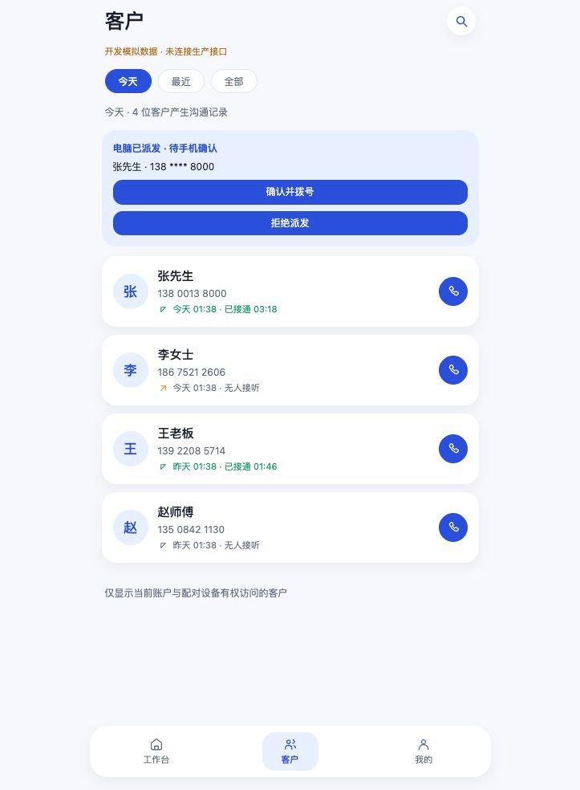
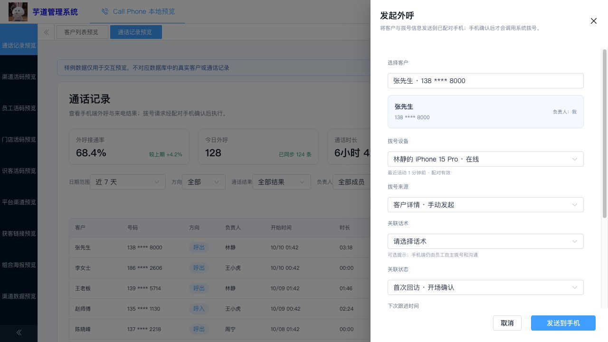
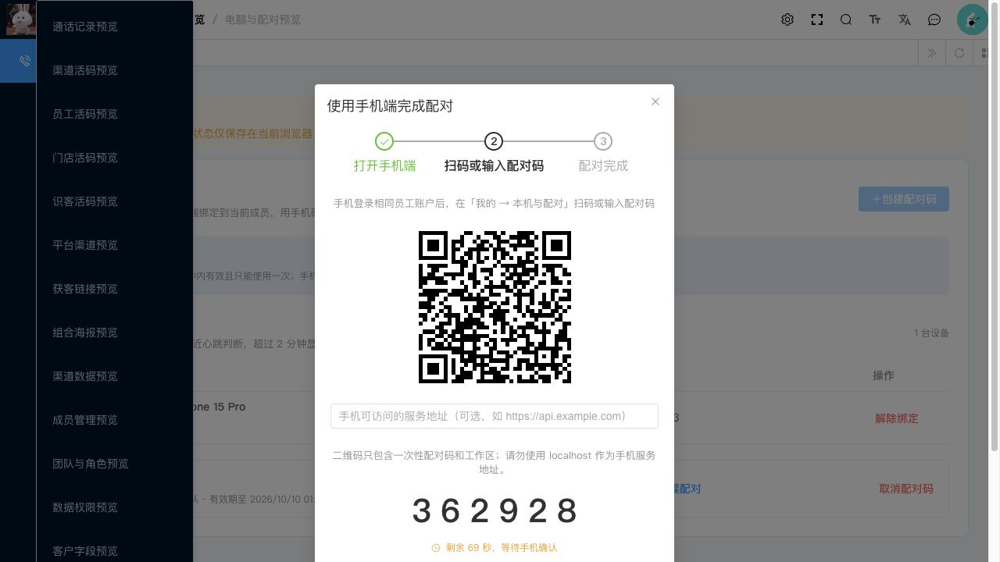
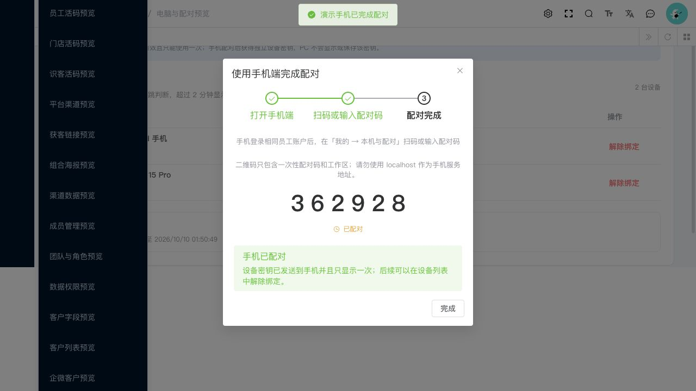

# PC / 移动端项目审查与修复记录

日期：2026-10-10。分支：`codex/feature/mobile-pc-integration`，由 `master → dev` 建立。根仓库原先仅有 `main`，没有 `master`；本轮在相同初始提交建立 master、dev 后进入 feature。内嵌开源仓库的历史/工作区基线未重置。

## 已修复

| 问题与影响 | 处理 |
|---|---|
| 原生空导航条与页面内标题叠加；状态栏/安全区重复留白 | 全页面关闭原生 titleNView，统一自定义 MobileHeader；安全偏移取最大值不累加。现有 Figma SVG 未替换 |
| 移动端只有内存 token 注入接口，无用户登录入口 | 接入已有员工登录、刷新和验证码协议；服务地址/tenant可配置，认证与设备密钥只存内存 |
| 移动公共接口放在 `.controller.app`，被框架变为 `/app-api/api/v1/mobile`，与客户端路径和员工身份不符 | 兼容控制器移到专属 `.controller.mobile` 包，保持 `/api/v1/mobile`，保留原 app-api 接口；加入真实 MVC 前缀测试，未修改全局框架 |
| 仅有手工配对码，PC无二维码；关闭弹窗丢失码后无法继续 | PC用已有 qrcode 依赖生成一次性 QR；手机扫码严格校验协议/工作区/地址，保留手输；支持继续配对与正确过期倒计时 |
| HTTP200 的业务失败被当成成功，未带工作区，写入刷新重放缺乏协调 | 同时校验 HTTP 与业务 envelope；每次带 tenant/设备头；刷新单飞，保留幂等键，隔离旧账号响应 |
| 配对认领返回 null、派发取消/过期仍继续操作 | null结果明确报错；PC取消竞争读取最终状态，解除绑定失败不显示成功 |
| PC客户“发起外呼”仅预览模式读取 customerId | 真实模式也读取客户 API并打开现有抽屉，路由复用时更新；派发防重复提交，搜索计时器卸载清理 |
| PC客户筛选沿用旧页码，时间字符串/数值处理不一致 | 筛选重置页码，统一日期解析；配对倒计时支持后端数值时间 |
| 切换移动客户筛选/页面返回造成请求和轮询竞争 | 列表请求版本保护、单一轮询、派发读取并发保护 |
| 无原生能力也先建通话；回调早于 activeCall赋值；可跨页面重复拨号 | 插件预检、先登记 activeCall再拨、全局单一通话与离开保护；无关来电过滤 |
| 插件一直不回应导致界面挂起或误判未拨号 | 15秒超时，超时单独标记待核对，允许用户确认实际结果 |
| 重试队列并发排空会重复上传/误删其他任务 | 单一重试执行，保留原事件和幂等键；结果失败明确提示待同步 |
| 服务端将响铃和填写结果等待时间算作通话时长 | 校验上限与时间窗后保留实际观测duration；无人接听保持0，传递真实结束回调时间 |
| 兼容控制器直接入口可能记录配对码/备注请求 | 在实际HTTP入口标记不记录请求体，保留原数据与权限校验 |

## 审查范围及功能现状

检查了客户列表/新增编辑/CSV导入/详情/筛选/分配/归档的调用契约，以及通话查询/统计/导出/录音、客户跳转拨号、设备选择、派发与结果工作流。已有功能继续复用；本轮没有替换图标或重写旧平台。CallPhone测试包括数据范围、导入/批量业务、配对、派发状态竞争、幂等、结果验证、录音存储及移动协议等。

仍存在的功能限制：当前原生拨号只支持含原插件的 Android；PC预览中的 iPhone 是合成 UI 样例，不代表 iOS拨号已实现。前台15秒轮询不是后台常驻接收。移动队列/令牌/密钥为进程内存，重启需要重新登录配对，杀进程不能恢复未同步结果。安全持久化、后台可靠接收与 iOS支持应另做专门实现。AI/企微等规划模块的外部服务能力不在此次客户/拨号联通验收范围。

## 验证证据

- 后端：JDK21下离线 Maven 构建与 CallPhone **115项测试通过，0失败/0错误/0跳过**。包括本轮新增路径、通话时长测试；不是启动真实数据库的整条链路测试。
- 移动：类型检查、Node测试、App资源与H5生产构建通过；12项测试覆盖真实TS模块的HTTP错误、工作区/设备头、令牌刷新、账号隔离、QR解析、空配对、原生预检、回调顺序、通话互斥、重试互斥、超时状态和无关来电过滤。uni与原生插件使用替身，无实际电话。
- PC：生产构建通过。全仓类型检查仍有10项旧错误，位于AI/BPM/FMS/IoT/MES；此次CallPhone修改文件没有新增类型错误。不能声称整个开源模板类型检查通过。大模板产物仍包含大量无关模块，作为架构拆分依据。
- 浏览器：实开移动开发页面，以手机尺寸核对标题位于 top0、自定义栏高52、原图标路径 `/static/figma/2-20-imgFrame.svg`，没有横向溢出；PC合成预览确认客户发起外呼带入张先生、QR显示与倒计时、关闭继续保留同一码、模拟认领状态更新。仅证明页面交互，不证明生产扫码/电话链路。
- App生成配置中确认 `titleNView:false`、navigation custom、statusbar dark；保留原插件ID与AppID。这是配置/资源验证，真实设备仍需检查。
- 联调脚本已完成语法与帮助输出检查，真实API流程尚未运行。

实际测试命令：

```sh
# apps/call-phone-uni
pnpm type-check
pnpm test
pnpm build:app
pnpm build:h5

# apps/ruoyi-vue-pro（本工作站使用JDK21）
mvn -o -pl yudao-module-callphone -am test \
  '-Dtest=**/cn/iocoder/yudao/module/callphone/**' -Dsurefire.failIfNoSpecifiedTests=false

# apps/ruoyi-vue-pro/yudao-ui-admin-vue3（使用Node24）
pnpm ts:check                   # 上述10项旧错误保留
pnpm exec vite build --mode env.local
```

## 尚未完成实机端到端验证

本轮访问 `127.0.0.1:48080` 超时，Docker管理接口也未在限定时间内响应；没有擅自重启或清空已有数据。没有可验证的含插件Android安装包与连线真机，因此**没有声称真实扫码、拨号或录音实机通过**。`dist/build/app` 是资源目录，不是APK。需要服务运行及含 Barcode/原电话插件的基座，按 [验收清单](mobile-pc-acceptance.md) 完成最后验证。

这也是影响“移动全部功能可用”最终确认的外部条件：代码链路与自动化回归已补齐，设备/服务运行结果尚待实测。可用 [服务端联调脚本](../../scripts/callphone-integration-smoke.py) 快速验证同账号跨端真实API，再验证原生电话。

## 页面截图（全部为合成预览）









## 架构输出

[模块边界与独立部署 ADR](../architecture/modular-deployment-adr.md)包含现状耦合点、方案比较、目录/依赖/分层、公共能力、模块注册与装卸、跨域业务、数据所有权、事件可靠性、独立制品发布/回滚以及渐进迁移门槛。架构结论：通信核心内部模块化；PC业务应用及AI/企微等外围业务独立制品/服务；通过版本化契约隔离旧代码，保持服务数量与事务成本可控。本轮输出设计，不把尚未实施的架构描述为已落地。
