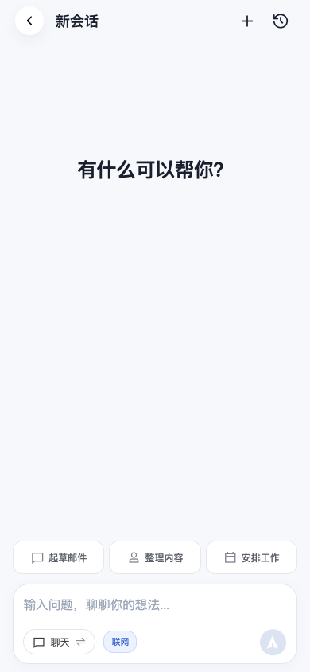
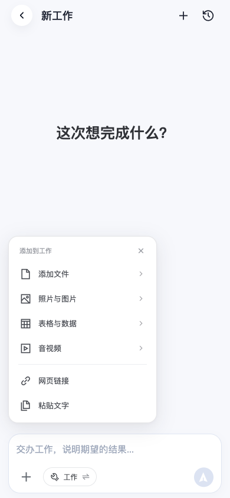
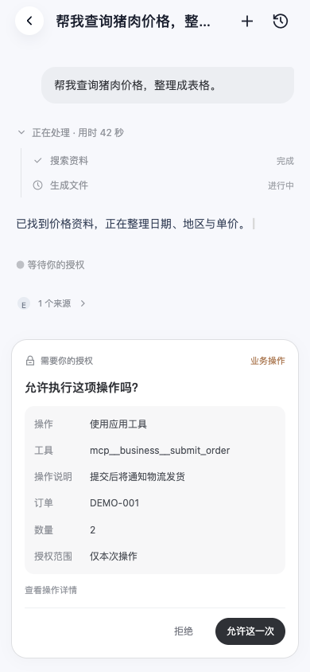
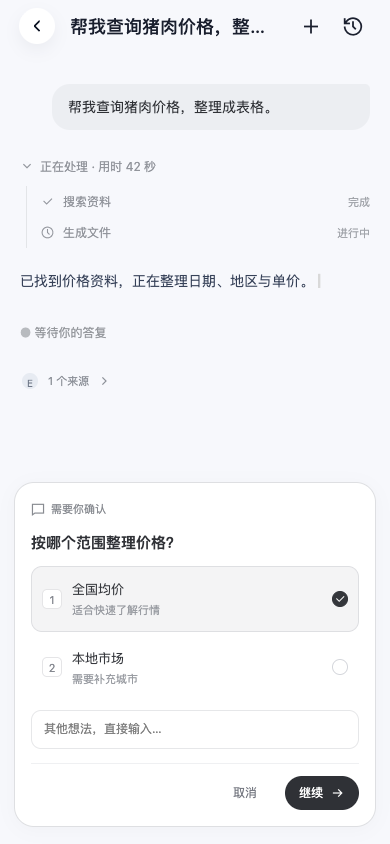
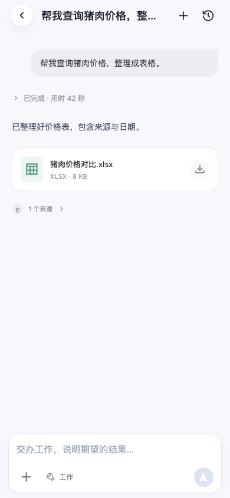
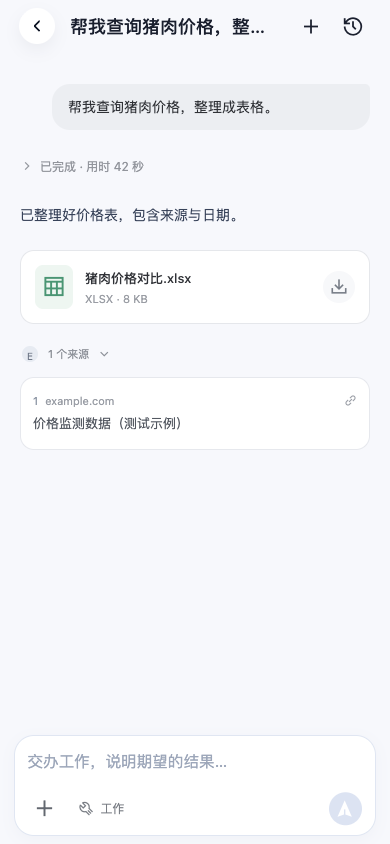

# Work 第二轮视觉预览

本地代码已修改；未部署、未发布 APK，待 Android 真机验证。以下使用合成接口数据展示组件状态，不代表真实价格数据或业务执行。

## 新会话：切换按钮、输入区上方三个快捷入口

## 工作添加：加号上方的列表菜单

## 授权：先核对字段，再单次允许

字段为操作、工具、实际目标/关键参数、授权范围；详情折叠。尚未配置的业务影响和可撤销性不猜填。

## 提问：编号选项与单独确认

## 完成：过程默认收起，灰色显示实际用时

## 来源展开与文件下载

参考本机 aiso 的站点/标题层次及文件图标/名称/描述结构，针对触屏保留下载按钮，来源默认折叠。

## 验证

- 类型检查通过；手机端 166 项测试通过。
- App 编译通过（沿用项目 Sass 弃用提示）。
- 浏览器 390×844 检查切换按钮、菜单、选项选中、授权卡片边界、搜索过滤、完成过程默认折叠与 42 秒持久事件用时，无页面运行错误。
- 授权真实副作用、Android 键盘和文件选择/下载仍须联调与真机验证。
- 字段契约及后续组件清单见 [交互规划](../modules/work-interaction-plan.md)。
