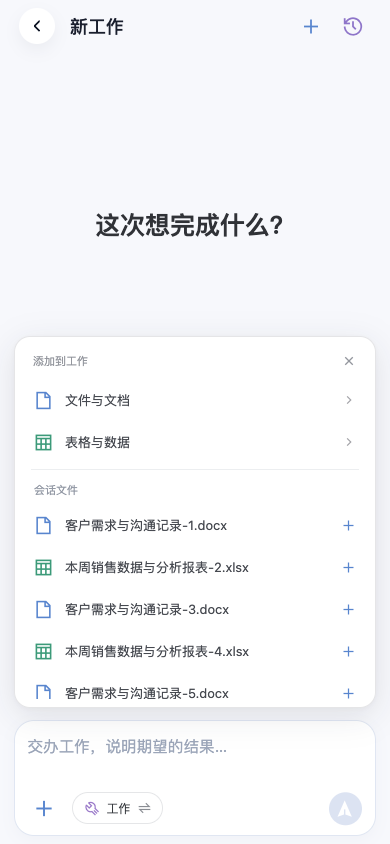
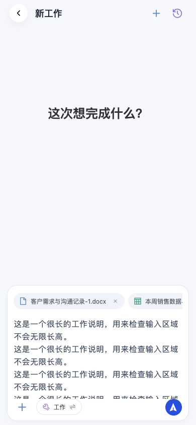
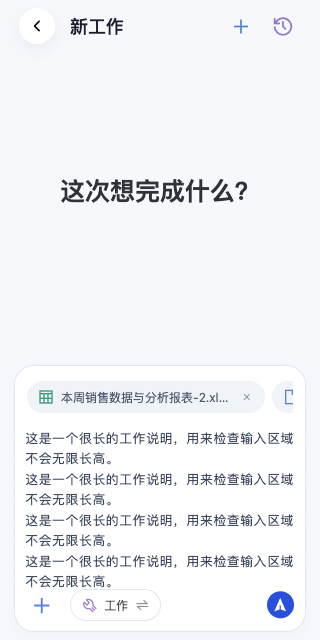

# Work 第三轮资源布局与安装包

日期：2026-10-16。浏览器截图使用合成资源，不代表真实业务资料。

## 添加面板

## 已选资源与长文本

## 验证

- 手机端 167 项测试、agent 20 项测试、Java MobileWorkControllerTest 4 项通过；类型检查、App 编译通过。
- 浏览器检查 390px / 320px 视口：菜单与输入框同为 362px 宽（390px 视口），菜单最大 320px；资源行 34px，不换行；文本最大 160px，能内部滚动，移除资源有效，无运行异常。
- 资源支持与限制、未来能力行规则见 [交互规划](../modules/work-interaction-plan.md)。本轮未逐种验证所有复杂文档。
- 本机后台与 agent 镜像重建、服务重启成功；重启前活动任务数为 0。
- 重启后真实 SDK 联调通过：临时设备鉴权、会话归属、原始 CSV 上传、隔离 Python 与文档依赖、鉴权下载字节、原生会话续接、旧产物不可变和移动端 SSE 回放。合成测试数据已清理。
- 安装包：`apps/call-phone-uni/dist/release/apk/tongzige-1.0.12-20261016-work-ui.apk`，版本 1.0.12（110），沿用 1.0.11 原生能力及个人签名证书，已验证原生代码与证书一致。
- SHA256：`d44fbca57af3b421679830559ecdbcc6276ce79da495ef4bd599c05bae598d62`。
- 已补充发布自动升级清单：通过手机使用的 Tailscale 地址验证 1.0.11 检查结果为可更新到 1.0.12；完整下载、签名、摘要、HEAD/Range 均通过，1.0.12 检查结果为已是最新。无需重启后台。
- 系统文件选择、软键盘、覆盖安装、下载和后台恢复仍待 Android 真机复验。
