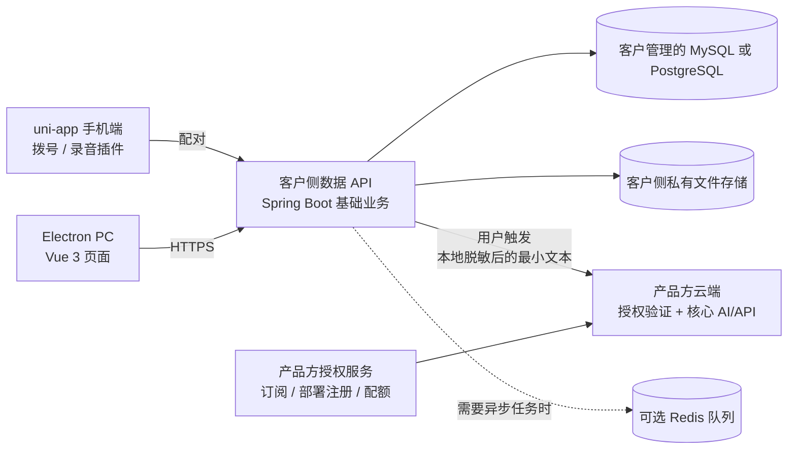

# 技术选型建议（初稿）

> 状态：候选底座已收敛，进入小范围试用验证后锁定。产品目标采用“可自部署的数据基础能力 + 产品方托管的授权与核心能力”混合模式。当前仓库没有产品源代码；尚未确认桌面端目标系统和 uni-app 拨号/录音插件名称，因此涉及原生能力和交付方式的结论待实际验证。

## 建议结论

| 层 | 建议 | 原因 |
|---|---|---|
| 移动端 | 保留现有 uni-app 和已验证的拨号、录音插件 | 不重做已解决的原生能力；由手机继续执行拨号与录音，PC 只发起请求和管理结果 |
| PC 桌面端 | Vue 3 + TypeScript + Vite，外壳采用 Electron | “ele什么”大概率是 Electron。团队若已有 Web/uni-app Vue 经验，Electron 的 Web 技术栈和桌面集成路径更直接，适合先覆盖 Figma 中的 PC 页面 |
| 后端基础模板 | 优先评估「芋道 RuoYi-Vue-Pro 完整单体版」，Java + Spring Boot + MyBatis-Plus | 已有系统权限、代码生成、多租户及 CRM 模块；比从 NestJS 空架子开始更能减少初期开发量。优先用单体版，避免首期引入微服务运维 |
| 客户侧数据服务 | 基于模板裁剪出的模块化单体，可容器化自部署 | 管理客户可控的数据读写和普通 CRM 工作流；支持本机、客户自有服务器或产品方托管部署 |
| 客户侧主数据库 | 先按模板默认的 MySQL 8 评估 | 模板默认围绕 MySQL；先用默认数据库可减少数据库方言和迁移脚本改造。模板也提供 PostgreSQL 配置/脚本，但需先跑完实际业务模块的兼容性验证再决定是否改用 |
| 产品方云端服务 | 独立部署的授权/验证服务与核心能力 API | 只保留订阅验证、授权状态、核心 AI/高级能力和用量计量；不承载全部 CRM 主数据，也不发布核心实现到客户侧安装包 |
| ORM / 迁移 | 沿用模板的 MyBatis-Plus；业务 SQL 随模块版本化 | 当前本地 Yudao 工程未配置 Flyway/Liquibase，模板升级主要使用 `sql/mysql/upgrade` 手动脚本。不要假设启动时会自动应用迁移；Call Phone 需在模块安装/升级流程里明确执行脚本，后续再评估统一迁移器 |
| 文件与录音 | 客户部署使用客户配置的私有对象存储，数据库只放元信息；产品方托管租户可用托管对象存储 | 录音不塞入关系型数据库；由所属数据平面执行访问权限检查 |
| 缓存 / 任务队列 | Redis 用于模板认证/缓存；异步任务按实际负载启用模板已有能力 | 首期用 Docker Compose 一起部署 Redis；不额外叠 BullMQ，避免跨 Java/Node 再维护一套队列 |
| PC 本地数据 | Electron 连接选定的数据服务；额外缓存最少化 | 数据服务可运行在本机、客户服务器或产品方托管环境；离线编辑可选 SQLite 和待同步队列 |

### 功能部署边界（首版建议）

| 可由客户本地/自有服务器独立运行 | 需要产品方服务在线 |
|---|---|
| 客户、线索、跟进、标签、基础分配与流转 | 账户/订阅验证、部署实例注册与云端用量计量 |
| 基础外呼派发、手机配对、通话结果和备注 | AI 话术生成、通话总结、跟进建议、知识库问答等受保护的 AI 推理 |
| 基础列表、筛选、统计、导入导出、基础审计 | 产品方提供的高级模型、专有算法和高级反滥用能力 |
| 组织成员/角色、业务字典、客户字段与本地备份 | 需要产品方连接器或产品方托管资源的增值集成 |
| 客户资料、线索、通话元信息、原始录音和原始转写可保留在客户存储 | 可由用户主动触发的云端 AI 请求；调用前客户侧脱敏，只传完成任务所需的文本/字段 |

这里的“可自部署”指运行位置和数据控制权，不等同于产品必须开源或永久免费。具体基础版授权、席位/实例限制与商用条款另行决定。基础数据功能不应通过把普通 CRUD 全部绑定云端授权来强制在线；如需商业限制，限制部署席位/实例或高级能力即可。

这里的“数据不经过服务器”指**不经过产品方服务器**；多人 PC/手机共享资料仍需要一台后端服务器。可将数据平面部署在客户自己的电脑/服务器上，使原始业务数据不离开客户控制范围。整体分成客户侧“数据平面”和产品方“控制/核心平面”。基础数据功能即便客户自行部署也可独立运行；调用受保护的核心能力时才经产品方服务验证并处理：

## 后端管理模板评估

### 首选候选：芋道 RuoYi-Vue-Pro 完整单体版

这是当前最值得做小型 POC 的候选，而非现在就盲目复制整套项目。官方项目提供 Vue 3 + Element Plus 管理端、Spring Boot 多模块单体、RBAC/数据权限/SaaS 多租户、代码生成器，并已有 CRM 模块；另有 PostgreSQL 配置示例。官方最近仍按月发版，同时维护 JDK 17/21 + Spring Boot 3.5 与 JDK 25 + Spring Boot 4.x 分支。[项目功能和技术栈](https://github.com/YunaiV/ruoyi-vue-pro) · [版本发布记录](https://github.com/YunaiV/ruoyi-vue-pro/releases) · [数据库配置示例](https://github.com/YunaiV/ruoyi-vue-pro/blob/master/yudao-server/src/main/resources/application-local.yaml)

建议采用完整**单体**工程做数据平面基础，使用其系统管理、权限、代码生成和必要 CRM 模块；裁掉商城/ERP/工作流等当前不需要的业务，不采用 Spring Cloud 微服务工程。通过自有模块边界分开客户数据、AI 网关、设备与外呼；产品方的授权与核心 AI/API 单独构建、单独部署，不能随自部署包发布。PC Figma 页面继续做自有产品 UI，可借管理端的 Vue 3/Element Plus 技术和通用组件，不照搬模板的后台视觉和菜单。

版本建议先以项目的 JDK 17/21 + Spring Boot 3.5 发布线作为 POC 基线，因为相对刚发布的 Boot 4 分支生态磨合时间更长；POC 时核对仍受维护的依赖和升级承诺，再固定精确 tag。模板默认以 MySQL 为主；如果你更重视 PostgreSQL，就必须用客户/线索/通话/权限/代码生成/升级迁移完整验证 PostgreSQL 路径后再定，不要只凭配置文件里有 JDBC 示例就视为完全兼容。

### 候选比较

| 候选 | 适配点 | 主要取舍 | 结论 |
|---|---|---|---|
| 芋道 RuoYi-Vue-Pro 完整单体版 | CRM、权限、多租户、生成器、Vue3 后台和移动端周边都较齐；MIT；数据库选项丰富 | 包含大量用不到的业务，体量大；需要裁剪、审查数据库和授权边界 | 首选 POC，按模块取用，不整套照搬 |
| Dromara RuoYi-Vue-Plus | Vue3、插件化、多租户、代码生成、MySQL/PostgreSQL，MIT | 6.x 切到 Spring Boot 4 并移除了多租户；5.x 是旧主版本线，缺少现成 CRM 业务 | 备选；若想要更精简框架，选用前先锁定维护分支及租户方案 |
| JeecgBoot | 低代码、Online 表单和代码生成较强，适合大量通用数据维护页 | 平台功能和自有扩展较多；仓库含额外授权条款、部分 LGPL 依赖，限制发布竞争性同类平台的条款需法务审阅 | 若后续主要痛点变成业务表单配置，再单独做低代码试点，不作为首个业务底座 |
| NestJS + Vue 管理端模板 | 和现有 uni-app / TypeScript 经验一致，前端复用自然 | 常见开源模板多偏管理端 UI 或通用 CRUD；还需自行补齐成熟 SaaS 权限、CRM、迁移、代码生成和运维模块 | 当前“最大程度减少初期工作”的目标下不作第一选择 |

芋道项目代码规模也很大（官方 2026.09 release 页面列出超过 64 万总行数），所以用它不代表把所有模块都接进产品。POC 必须验证“裁剪后仍能独立构建/升级”，并审查代码生成物是否容易脱离模板规范。[v2026.09 发布说明](https://github.com/YunaiV/ruoyi-vue-pro/releases)

### 选型 POC 的通过条件

用一到两周做垂直切片，不先迁移整份菜单：

1. 启动单体版，裁掉非目标模块；提供 Docker Compose 部署，让空白环境按文档可启动。
2. 完成成员/角色/数据范围，以及 workspace/tenant 隔离；验证任意两个租户不能横向读取客户、线索、通话或文件。
3. 用框架生成一个带筛选、分页、详情、导入校验和审计的实体，再手工实现一条通话派发/同步流程，检查生成器和业务扩展能否共存。
4. 用现有 uni-app 连通客户侧 API，验证认证、设备配对和通话结果幂等同步；PC 端另走同一 API。
5. 验证客户侧无产品方网络时，基础 CRM、外呼记录、备份和恢复仍正常；AI 请求明确走脱敏网关去产品方云端。
6. 做一次版本升级演练、数据库备份恢复和高危默认配置审查；再锁模板 tag、数据库和是否保留模板 CRM 模块。

若其中租户权限、表结构/ORM 扩展、MySQL 部署/迁移或部署裁剪任一项需要大面积修改，就放弃整套底座，退回“Spring Boot 官方构建 + 精简的 RuoYi 系统模块/组件”或其他候选，而不是让未来业务长期受模板约束。

## 客户数据脱敏后调用核心 AI

如果客户数据完全不进入产品方服务器，云端只能处理用户主动提交的脱敏内容；不能让云端核心 AI 自动查询客户数据库。折中数据流建议如下：

1. 原始姓名、手机号、录音/转写、替换映射表都留在客户侧数据平面。
2. 用户点击 AI 操作后，由客户侧网关先去除姓名、手机号、邮箱、地址、公司/门店名称、账号号等直接标识符，并检查自由文本里的罕见事件、精确时间地点、职位组合等间接识别线索。
3. 为当前请求随机生成占位符（如 `联系人A`、`号码A`），本地保留映射以便结果回来后还原；服务端没有映射，也不要把原手机号直接哈希后上传，因为号码空间容易被枚举。这属于去标识化/假名化处理，不应误称为真正匿名化。
4. 只把任务需要的最短文本和字段发送到产品方核心 API。产品方不保存原始 prompt/response，不拿输入训练模型，访问日志只留调用 ID、功能、时间、用量、状态等最小运营数据；上游模型供应商也必须满足同等不保留/不训练要求。
5. AI 返回后，客户侧过滤输出并在本地把占位符还原；最终摘要、建议和原文关联仅写入客户侧数据库。

这能显著减少产品方接触直接标识符，但“删掉姓名/手机号”本身不保证真正匿名。对话上下文和独特事件仍可能识别到个人；中国《个人信息保护法》把“匿名化”定义为无法识别且不能复原，把去标识化视为不同概念。实际是否仍构成个人信息/如何告知与授权，要结合数据、处理目的和部署地区做专业评估，不能仅凭技术替换字段下结论。[《个人信息保护法》定义](https://www.miit.gov.cn/jgsj/zfs/fl/art/2022/art_515a4b20c12f430eab54bb4f56d89f56.html) · [网信办对脱敏与去标识化的说明](https://www.cac.gov.cn/2024-03/22/c_1712776611649184.htm)

如果要求**任何客户文本也绝不经过产品方服务**，那就只能将 AI 模型也运行在客户自己的环境，或让客户自行配置模型服务；代价是核心模型/算法随本地部署交付，不能再靠产品方云端执行来保护它。这个是隐私与核心能力保护之间的明确取舍。

## 桌面端：Electron 与 Tauri

目前推荐 **Electron**。Tauri 2 值得保留为备选：它使用系统 WebView，包体通常更轻，并用 capability 限制前端可调用的系统能力；但需要 Rust 核心及 IPC 边界管理。Electron 带 Chromium/Node 运行时，体积和资源占用更高，但对熟悉 Web 的团队通常更容易做系统托盘、自动更新、文件处理和跨平台打包。Tauri 官方也明确指出 Rust 核心与前端 WebView 是不同信任边界；两种壳都不能替代服务端授权。[Tauri 安全模型](https://v2.tauri.app/security/)

选 Electron 的安全基线：

- 页面只加载安装包内的可信前端资源；远程页面不得开启 Node 集成。
- 所有 renderer 开启 `contextIsolation`、进程 sandbox 和 CSP；只经 preload 暴露白名单 API。
- IPC 校验发送方与参数；限制导航、弹窗和外部链接；持续升级 Electron / Chromium 及依赖。
- 构建产物做 macOS / Windows 代码签名；自动更新校验签名。`asar`、混淆或完整性检测用于提高逆向成本和发现篡改，不作为授权或数据安全边界。

这些设置对应 Electron 官方安全清单，包括上下文隔离、sandbox、CSP、IPC sender 校验、限制导航、保持版本更新等。[Electron 安全建议](https://www.electronjs.org/docs/latest/tutorial/security)

## 两个服务平面与数据库边界

### 客户侧数据平面（可自部署）

- 以基于芋道裁剪的 Spring Boot 模块化单体提供基础业务 API，包含 `customers`、`leads`、普通 `calls`、团队配置、基础报表、设备配对、文件元数据和审计等模块。它可在本机、客户自己的服务器或产品方托管环境运行。
- MySQL 是 POC 的主数据源。客户决定数据库、文件存储、备份和网络边界；录音等大文件放客户可管理的私有对象存储。每条业务数据带 `tenant_id` / `workspace_id`，应用层和模板租户插件执行对象与字段级权限校验。
- 对外发布可部署容器和配置模板。源代码是否公开、基础版授权条款和商用边界是产品/商业决策，技术上可先按可部署发行包实现，不默认承诺开源。
- 客户管理员控制自己部署的主机和数据库，因此本地数据平面的代码和数据无法对该管理员做到不可查看或不可修改。此部分属于明确接受的风险范围。

### 产品方控制/核心平面（不自部署）

- 单独运行订阅与部署注册服务、授权校验、配额/风控和核心 AI/高级能力 API。高级功能的算法、模型供应商凭证、系统提示词及最终额度判断只在产品方控制的服务端执行。
- 每个客户部署实例在产品方注册并拥有可轮换/可撤销的实例凭据；PC 与手机不持有产品方服务密钥。普通 CRUD 不依赖产品方服务持续在线；调用核心能力时，客户侧服务端向产品方 API 请求短时授权并提交最少必要的输入。
- 产品方服务每次请求重新验证实例订阅、用户/席位和功能权限，做速率/额度限制、审计和异常检测。来自自部署实例的用户权限声明不能单独作为可信依据；核心服务应对高风险操作采用产品方签发的短期授权/额度凭证。
- 客户侧实例凭据最终由客户管理员控制，理论上可被提取或伪造请求。因此不能承诺防止付费租户把核心 API 代理给别人；应配合在线撤销、配额、并发限制、滥用检测和合同约束。真正核心实现不下发到客户环境。
- 如果核心 AI 要读取客户数据，由客户侧服务明确发起，并只发送完成任务所需的字段/片段；在页面和部署配置里明确数据出境/处理状态。不要让产品方云端常驻读取客户数据库。

### 数据库、文件与外呼细节

1. 模板租户插件提供应用层租户隔离，但不能只看“多租户已集成”就视为安全；POC 必须逐接口验证查询、导出、导入、异步任务、文件和代码生成都带租户上下文。若最终选择 PostgreSQL，可评估再用 RLS 做纵深防御。[PostgreSQL 行级安全](https://www.postgresql.org/docs/current/ddl-rowsecurity.html)
2. 客户侧 API 检查文件权限和元信息后使用私有对象存储；核心服务不得长期持有对象存储凭证。需要分析录音时由客户侧 API 获取有限时长的临时读取凭证或最小化转写文本。
3. AI 请求由客户侧 API 代理到产品方核心 API；模型供应商 API key、系统提示词、授权判断和额度计量不放进桌面安装包或可自部署包。
4. 通话记录与派发请求分开：PC 创建 `call_dispatch`，手机确认后才拨号；通话结果由手机回传客户侧数据服务。此流程与 [外呼模块设计](modules/outbound-calling.md) 保持一致。

## 面对本地逆向与破解的防护策略

把目标定为：让基础数据功能可由客户自行掌控；保护产品方的核心算法、AI 能力、账号、服务额度，并提高批量盗用成本。不能承诺“客户端或客户自部署端无法破解”：拥有管理员权限的人可能分析或修改本地程序、读取运行时内存，AI 工具会降低这类工作的门槛；代码混淆、加壳、设备指纹都只能增加成本。

### 必须在可信服务端执行

- 产品方核心 API 每次请求都验证部署实例状态、订阅、功能权限和额度；隐藏按钮、客户端逻辑或本地 license 文件都不构成核心功能授权。
- 核心 AI 和高级能力由产品方服务端计量、限流和审计；供应商密钥只存服务端密钥管理设施。普通客户数据读写留在客户部署侧，不必因 license 验证而全部上传。
- 授权按 workspace / 用户席位 / 部署实例 / 配额表达；支持撤销、续期、并发限制和异常使用检测。设备或部署 ID 本身可伪造，不能当成硬件级不可复制身份。
- 桌面和手机使用短期访问令牌及轮换刷新令牌；手机配对凭据可单设备撤销。服务端保存刷新令牌哈希，不在日志打印令牌。
- 关键写操作做速率限制、幂等和审计；异常可触发重新认证、冻结令牌或人工复核。

### 客户端与本地数据

- 只缓存实现离线所需的最少字段；手机号、录音等敏感数据尽量不长期落本地。确需缓存时采用 OS Keychain / Credential Manager 保存包装密钥，数据库加密，并提供会话退出后的缓存清理。
- 数据基础功能按客户自己的部署可用性运行，不因产品方验证服务短时不可用而锁死客户数据。高价值云端核心功能需要在线访问产品方 API；不在本地发行包内留可离线解锁核心功能的密钥。
- 离线操作保存事件队列、幂等 ID、创建时间和基于版本的冲突信息；同步时服务端重新校验权限，不能因为本地曾获准就永久接受。
- 本地备份加密，备份密钥与数据分离；恢复时重新校验 workspace 和成员权限。

### 发布链路与可选威慑

- CI 构建可复现并保护签名私钥；发布安装包签名，更新清单和更新包均做签名/校验，支持撤回和密钥轮换。electron-builder 提供更新清单签名能力，私钥应只保存在受控 CI 秘密中。[签名更新清单](https://www.electron.build/docs/features/signed-update-manifests/)
- 可做代码压缩/混淆、ASAR 完整性校验、反调试信号、导出水印和异常遥测，作为威慑与发现手段；避免把大量精力投入“永不被破解”的承诺。
- 客户自托管的数据平面允许其管理员查看、修改或分叉；保护核心能力依赖产品方 API 持续执行服务端授权，而不是试图藏住整套本地程序。产品方核心服务须能撤销实例凭据、限额和隔离滥用实例。

## 部署与演进

- 初期交付一个可自部署的数据平面发行包（裁剪后的 Spring Boot 单体 + MySQL + Redis + 私有文件存储配置），另部署产品方授权/核心 API；产品方自己的 SaaS 租户也使用同一数据平面代码和 schema，避免分叉两套业务实现。
- 自部署用户自行运维自己的数据库和文件；产品方托管版负责备份、监控和升级。提供迁移工具和版本兼容策略，但由管理员决定何时升级。
- 需要多实例时先保持各平面 API 无状态；增加 Redis 做队列、短时缓存或 WebSocket 横向协调。只有模块出现独立扩缩、团队边界或故障隔离需求后再拆服务。
- 对 API 保持 `/api/v1` 版本前缀；数据库变更走向前兼容迁移，桌面端支持受控升级。
- 拨号和录音始终由现有手机插件承担。插件具体 API、录音文件可访问方式、OS 版本限制需在实现外呼同步前核实；不把 Electron 设计成直接替代手机电话能力。

## 需要确认后锁定的产品假设

1. 已按你的补充，将“数据基础功能自部署、授权验证与核心能力由产品方托管”作为目标架构；需确定首批可自部署的功能白名单与不可自部署核心能力清单。
2. PC 优先覆盖 Windows、macOS 还是两者？这影响签名证书、打包与自动更新成本。
3. 完全断网的客户环境是否允许基础数据功能运行？建议允许数据基础功能运行，但云端核心 AI/高级能力在断网时不可用。

## 参考资料

- [Electron 安全建议](https://www.electronjs.org/docs/latest/tutorial/security)
- [Tauri 2 安全模型](https://v2.tauri.app/security/)
- [芋道 RuoYi-Vue-Pro](https://github.com/YunaiV/ruoyi-vue-pro)
- [Spring Boot 文档](https://spring.io/projects/spring-boot)
- [JeecgBoot 前端许可及补充条款](https://github.com/jeecgboot/JeecgBoot-vue3/blob/master/LICENSE)
- [PostgreSQL 行级安全策略](https://www.postgresql.org/docs/current/ddl-rowsecurity.html)
- [electron-builder：签名更新清单](https://www.electron.build/docs/features/signed-update-manifests/)
