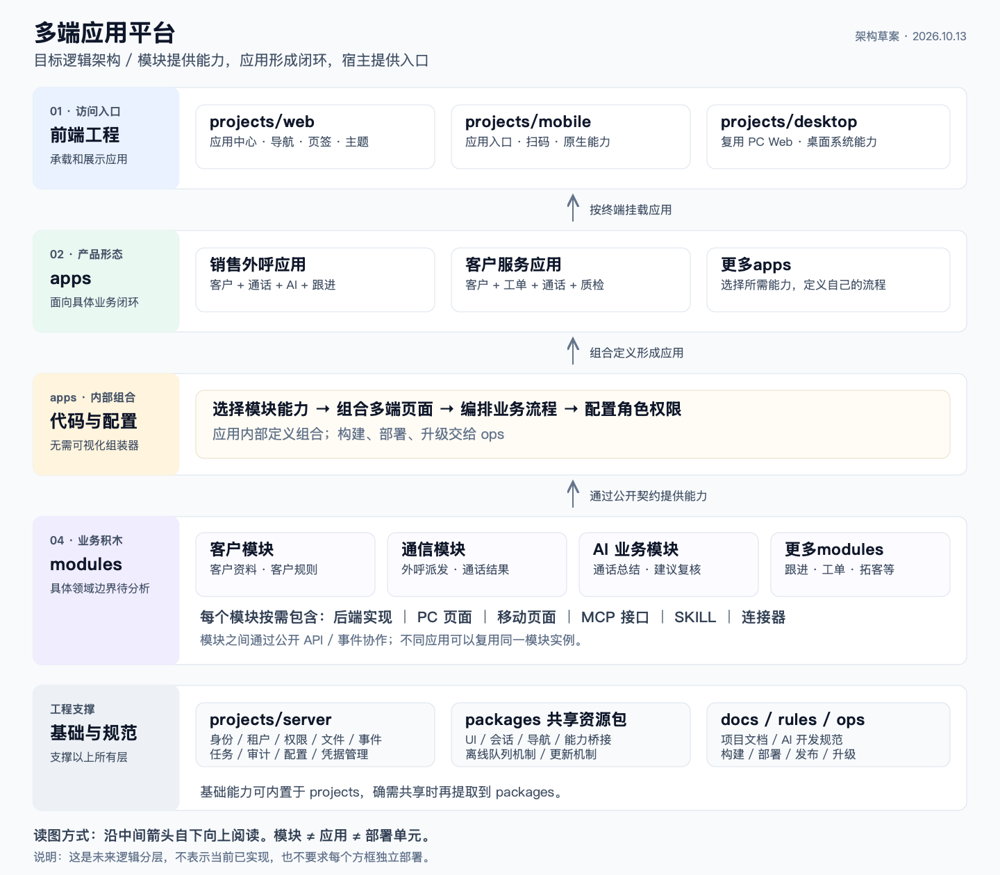
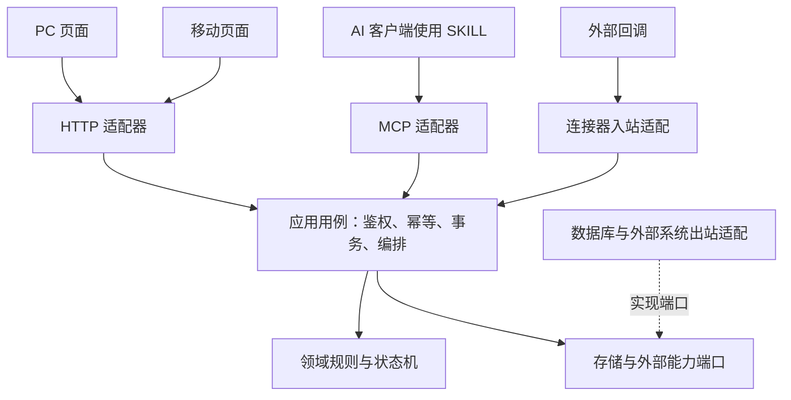

# 多端应用平台架构蓝图

> 命名更新：当前运行工程目录已改为 `containers/`；运维目录已改为 `devops/`；本文及归档图中的 `projects/`、`ops/` 是历史命名，保留用于记录早期设计。
> 历史设计资料：2026-10-19 从外部 docs 迁入。目录命名、框架工程组织及扩展规范以 `next/README.md` 和 `next/docs/rules/README.md` 为准；本图保留早期方案，不代表最新定稿。

日期：2026-10-13。状态：目标设计，尚未实施架构迁移。

基于 `codex/feature/mobile-pc-integration` 的 `104f8338e5f610968bda9c376cd640fb0f8528e1`，在 `codex/architecture/multi-app-platform` 分支整理。本轮只增加设计资料，不移动现有业务代码，也不创建不可运行的空工程。

## 1. 总体架构

[矢量图](architecture.svg) · [Mermaid 源码](architecture.mmd) · [项目骨架与迁移路径](project-skeleton.md)

顶层目录定为 **`apps`、`projects`、`packages`、`modules`、`docs`、`rules`、`ops`**。自下向上阅读：领域模块提供能力，应用用代码与配置组合能力，三个前端挂载应用，一个后端加载领域实现和应用流程。基础能力可内置于工程，也可抽成共享包。图中应用组合是应用内部职责，不是独立组装器产品。

## 2. 三个不能混用的概念

| 概念 | 定义 | 示例 |
|---|---|---|
| 领域模块 | 拥有规则、数据和公开能力的业务边界 | 客户、通信、跟进 |
| 业务应用 | 面向一种业务目标的页面、能力、权限与流程组合 | 销售外呼、客户服务 |
| 部署单元 | 可以独立构建、发布和运行的制品 | communication-core、ai-service |

一个应用可以使用多个模块；一个模块可以被多个应用使用；几个模块也可以共同组成一个部署单元。目录独立不代表已经能够独立发布。

图中的客户、通信、AI 等仅用于说明领域模块概念，具体模块边界尚未确定；“客户服务应用”和工单、质检等是未来组合示例，不代表本仓库已实现。

## 3. 各层职责

| 层 | 负责 | 边界 |
|---|---|---|
| 多端宿主 | 登录、应用中心、工作区、导航、主题、终端能力桥接 | 不保存客户/通话业务规则；桌面宿主复用 Web |
| 业务应用 | 选择能力、组合页面、定义角色和跨模块流程 | 不直接访问业务表，不复制模块实现 |
| 应用组合代码与配置 | 在 `apps` 内选择能力、组合页面、编排流程 | 不建设独立可视化组装器；构建校验与发布工具归 `ops` |
| 领域模块 | 领域模型、用例、事务、数据、多端业务界面、开放与集成适配 | 只能通过公开契约访问其他领域 |
| 基础设施 | 身份、租户、权限机制、文件、事件、任务、审计、凭据和终端基础能力 | 不承接具体业务语义 |
| 应用运行支撑 | 安装实例、配置绑定、流程状态持久化、恢复、通用任务执行 | 通用引擎属于平台，业务流程定义属于应用 |

Server 基础平台可以与业务部署在同一环境，但保持代码边界。若未来需要产品方授权/模块分发服务，它与客户侧业务环境分离，不能默认把客户数据集中到产品方服务。

## 4. 模块内部结构

模块按需交付后端、Web、移动页面、MCP、SKILL、连接器，不要求每个模块全部具备。SKILL 是任务方法与工具使用说明，不授予权限。所有入站操作复用应用用例，服务端执行权限和租户隔离。

连接器的凭据保存、认证刷新和通用重试机制属于平台；外部字段映射、同步语义、冲突处理属于领域模块。

## 5. 组装与运行分开

应用组合通过 `apps` 中的代码与配置表达，不规划可视化组装器。构建阶段由 `ops` 中的工具按需要检查依赖、兼容和版本，生成发布物；不单独设置组装器工程。

运行阶段由 `projects/web`、`projects/mobile`、`projects/desktop` 加载对应终端入口；`projects/server` 提供公共基础能力、运行选定模块后端和应用流程。应用安装、配置与流程执行机制先在工程内实现，确有共享需要再提取到 `packages`。普通领域查询或操作可以直接调用模块 API，无须经过工作流引擎。

长流程在服务端持久化，记录步骤、输入引用、幂等键、超时、重试与人工处理状态。流程实例绑定启动时的定义版本，升级不能把进行中的实例静默切换到新流程。业务写入与 Outbox 同事务，消费方去重；至少一次交付不能被当作恰好一次执行。

例如：通话保存完成 → 发布通话完成事件 → AI 生成摘要 → 人工复核 → 跟进模块创建任务。AI 失败不回滚已结束的通话。外呼等外部动作重试前必须核对状态，不能盲目重放。

## 6. 数据和身份边界

- 区分 `tenantId`（租户）、`appInstallationId`（应用安装实例）、`moduleInstanceId`（领域模块实例）；应用 ID 不是天然数据隔离边界。
- 同租户两个应用可以绑定同一个客户模块实例以共享客户数据；需要隔离时显式创建不同业务空间/模块实例。首期按真实需求实现，不能只加一个字段就声称隔离完成。
- 每张业务表只有一个写入所有者。跨域查询优先公开查询接口或只读投影，不共享 ORM 实体，也不跨域直写表。
- 平台权限机制与模块领域授权同时生效；菜单显示和应用启用状态不能代替服务端授权。
- 应用关闭阻止新流程，已有流程按策略收尾；卸载、权限撤销、数据删除是不同操作，不能绑定成一个动作。

## 7. 多端挂载原则

| 终端 | 首期挂载方式 | 演进方向 |
|---|---|---|
| PC Web | 路由级应用入口，独立前端制品试点 | 验证后再选运行时远程装载方案 |
| 移动 APP | 页面/原生适配随安装包编译，配置控制已具备能力的入口 | 按平台约束扩展；新增原生能力仍需安装包升级 |
| 桌面 | Web 宿主加受控桌面桥接 | 桌面壳和 Web 业务版本分别管理 |

宿主提供会话、导航、受控请求、通知和终端能力查询。模块不得直接访问宿主私有 store、原始凭据或任意系统接口。前端入口缺失、版本不兼容、原生能力不支持时，应在安装/加载时明确拒绝或降级。

## 8. 与现有方案的关系

本蓝图按用户确认的七个顶层目录组织，以三个前端工程和一个后端工程为当前目标，不再采用早期独立组装器及多个后端入口的骨架。既有 [模块独立部署 ADR](../../../../docs/architecture/modular-deployment-adr.md) 的公开契约、数据所有权和渐进迁移原则继续适用；其目录和拆服务建议属于历史方案，不作为本轮实施前提。

现有文档对历史方案和实现状态已有提示；本蓝图不把历史目录建议当成当前实现。新的代码迁移应按 [项目骨架](project-skeleton.md) 分阶段开展。

## 9. 完成架构迁移的验收依据

1. 第二个应用可复用已有模块，不复制其规则、数据访问或整套页面。
2. 新增业务应用不要求向宿主加入领域判断。
3. 一个可独立发布的模块升级不重建不相关制品，旧契约消费者继续可用。
4. 手机离线、应用关闭、AI 失败、事件重复均不会破坏已完成业务或重复执行外部动作。
5. 禁止跨域实现导入和跨域直写表，检查能在 CI 中阻止新增违规。
6. 发布版本可追溯，进行中流程能继续运行；回退应用版本不宣称自动逆转不可逆数据迁移。
